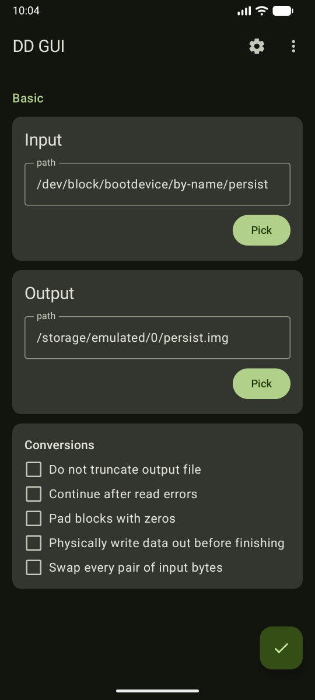
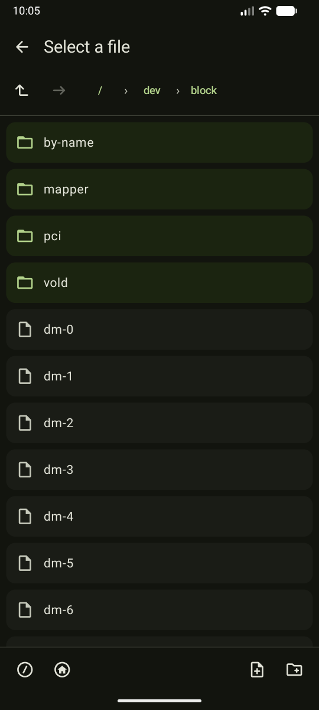
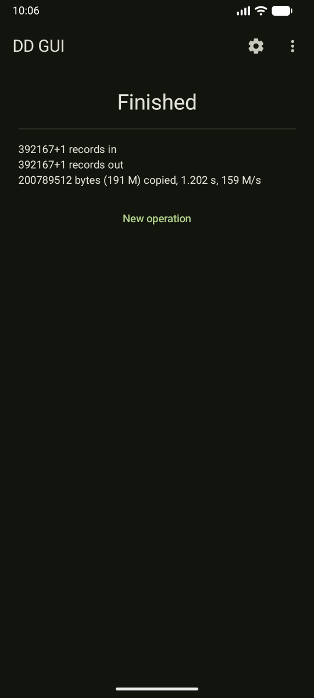

<p align="center">
  
</p>

# DD GUI

DD GUI is a graphical interface for running the `dd` command on Android. Select input and output paths, choose supported conversions, and review each write before execution.

**Root access is required.** The app cannot guarantee that a selected path is accessible on every device.
Supports Android 7.0 (API 24) and later.

[](https://github.com/Lennoard/DDGUI)
[](LICENSE.md)


## Features

- Copy data between selected files and explicitly selected block-device paths, including image backup and write workflows, subject to device access restrictions.
- Choose input and output paths with the root-aware file picker; browse directories and create files or folders.
- Select `dd` conversions: `notrunc`, `noerror`, `sync`, `fsync`, and `swab`.
- Review the exact source, destination, and selected conversions before a write. The Settings option can hide repeat warning dialogs, but a review and separate final confirmation are always required.
- Select a special or unrecognized filesystem entry, such as a possible boot or recovery block device, after an explicit warning. This does not test whether Android or the device permits access.
- Use adaptive Compose layouts for compact and wider windows.

## Safety

Writing to a block device can permanently destroy data or make a device unbootable. 
Check the source and destination carefully before confirming.
DD GUI does not discover or verify partition layouts, determine whether an image is compatible with a device, or bypass Android root and security restrictions.

## Technologies

- Kotlin and Android Gradle Plugin with Gradle Kotlin DSL
- Jetpack Compose, Material 3, and Navigation 3
- Kotlin Coroutines and `StateFlow`
- libsu for root shell and filesystem access
- Koin for dependency injection

## Screenshots

<div align="center">

|                                                             Main operation                                                             |                                                              Root file picker                                                               |                                                 Completed operation                                                 |
|:--------------------------------------------------------------------------------------------------------------------------------------:|:-------------------------------------------------------------------------------------------------------------------------------------------:|:-------------------------------------------------------------------------------------------------------------------:|
|  |  |  |

</div>

## Download

<a href="https://apt.izzysoft.de/fdroid/index/apk/com.androidvip.ddgui"></a>
<a href="https://xdaforums.com/t/app-7-0-dd-gui-a-graphical-interface-for-the-dd-command.4054763/"></a>

## Build

The project uses Gradle 9.6, Android Gradle Plugin 9.5, Android SDK 37, and Java 11 bytecode. Use a JDK supported by the pinned Gradle and Android Gradle Plugin versions, and install Android SDK Platform 37.

```sh
./gradlew :app:assembleDebug
./gradlew test
```

## License

This project is licensed under the MIT License. See [LICENSE.md](LICENSE.md).
